# Building and Booting a Yocto Image for the Jetson Nano B01

A step-by-step guide to building a custom Linux image for the **NVIDIA Jetson Nano Developer Kit (B01)** with Yocto (`poky`) and the `meta-tegra` layer, flashing it, booting it, and building out-of-tree kernel modules for it.

## Contents

1. [Overview](#1-overview)
2. [Get the sources](#2-get-the-sources)
3. [Select the meta-tegra branch](#3-select-the-meta-tegra-branch)
4. [Identify your board and machine](#4-identify-your-board-and-machine)
5. [Create the build directory](#5-create-the-build-directory)
6. [Configure layers and `local.conf`](#6-configure-layers-and-localconf)
7. [Build the image](#7-build-the-image)
8. [Write the root filesystem to the microSD card](#8-write-the-root-filesystem-to-the-microsd-card)
9. [Flash the bootloader and boot](#9-flash-the-bootloader-and-boot)
10. [Build out-of-tree kernel modules (`.ko`)](#10-build-out-of-tree-kernel-modules-ko)
11. [Transfer a module over UART](#11-transfer-a-module-over-uart)
12. [Verify the module and device tree overlays](#12-verify-the-module-and-device-tree-overlays)
13. [Troubleshooting](#13-troubleshooting)
14. [Notes for Jetson Orin Nano](#14-notes-for-jetson-orin-nano)

---

## 1. Overview

| Item | Value |
| --- | --- |
| Target board | NVIDIA Jetson Nano Developer Kit, B01 revision |
| SoC | NVIDIA Tegra X1 (Tegra210) |
| Yocto release | `kirkstone` |
| BSP layer | [`OE4T/meta-tegra`](https://github.com/OE4T/meta-tegra), branch `kirkstone-l4t-r32.7.x` |
| Machine | `jetson-nano-devkit` |
| Images tried | `core-image-base`, `core-image-full-cmdline` |

**Boot flow differs from the stock Ubuntu image.** The stock Ubuntu 18.04 image keeps the kernel, bootloader and DTB on the microSD card, so you only insert the card and boot. With `meta-tegra` the boot chain is **bootloader → SPI flash → SD card**, so you must flash the bootloader to the board's SPI flash over USB (recovery mode) *and* write the root filesystem to the microSD card.

---

## 2. Get the sources

Clone Yocto's reference distribution, `poky`, into the directory you will build in, then switch to the `kirkstone` branch:

```bash
git clone https://git.yoctoproject.org/poky
cd poky
git checkout kirkstone
git status          # confirm you are on the kirkstone branch
```

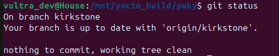

Then clone `meta-tegra` **inside the `poky` directory**:

```bash
git clone https://github.com/OE4T/meta-tegra
```

The Jetson Nano uses the Tegra X1 SoC, and `meta-tegra` is the layer that provides machine definitions for Tegra boards.

After this step `poky/` should contain the usual Yocto directories plus `meta-tegra` (the `build` directory is created later).

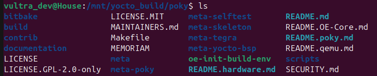

---

## 3. Select the meta-tegra branch

> **Important:** the branch must match your hardware. If the architecture is wrong, the image may build successfully but will not run.

```bash
cd meta-tegra
git status
git checkout kirkstone-l4t-r32.7.x
```

Expected result:


The branch `kirkstone-l4t-r32.7.x` supports the older Tegra generation (including the Jetson Nano). To see which machines a branch supports, list `meta-tegra/conf/machine/`.

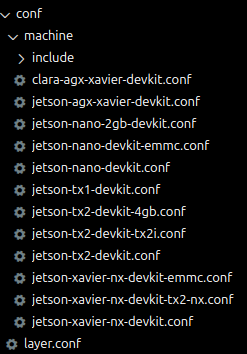

For newer boards such as the **Jetson Orin Nano**, see [section 14](#14-notes-for-jetson-orin-nano).

---

## 4. Identify your board and machine

Before choosing a machine, check exactly which board you have. Run these **on the Jetson itself** (running the stock Ubuntu image):

| Command | Purpose |
| --- | --- |
| `cat /proc/device-tree/model` | Board name |
| `uname -a` | Kernel version, SoC, architecture |
| `cat /sys/firmware/devicetree/base/compatible` | SoC / chip ID |
| `head -n 1 /etc/nv_tegra_release` | L4T release / board |

Example output for a Jetson Nano B01:

```text
NVIDIA Jetson Nano Developer Kit
Linux <hostname> 4.9.253-tegra #1 SMP PREEMPT Sat Feb 19 08:59:22 PST 2022 aarch64 aarch64 aarch64 GNU/Linux
nvidia,p3449-0000-b00+p3448-0000-b00  nvidia,jetson-nano  nvidia,tegra210
```

Compare these identifiers with the `KERNEL_DEVICETREE ?= "..."` line (the `.dtb` file name) in the machine's `.conf` file under `meta-tegra/conf/machine/`:

| String | Meaning |
| --- | --- |
| `p3449-0000-b00` | Jetson Nano Developer Kit carrier board |
| `p3448-0000-b00` | Jetson Nano SoM (module) |
| `nvidia,jetson-nano` | Jetson Nano device identifier |
| `nvidia,tegra210` | Tegra X1 (T210) SoC |

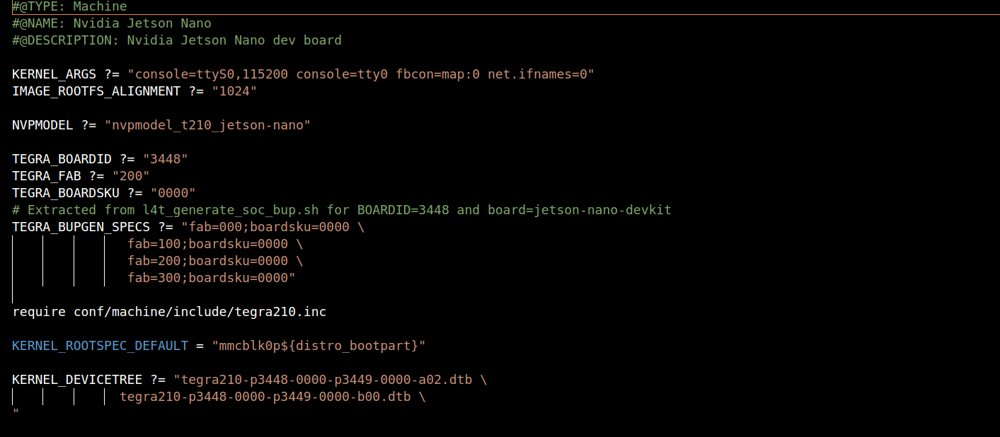

The machine whose DTB name matches your board is the one you use. For the Nano B01 it is **`jetson-nano-devkit`**.

---

## 5. Create the build directory

From inside `poky/`:

```bash
source oe-init-build-env <build-dir-name>
```

The directory name is arbitrary.

**Build location tips (Ubuntu host):**

- If you build on a separate drive, make sure it is mounted somewhere you can write to:

  ```bash
  sudo umount /dev/nvme...
  sudo mount /dev/nvme... /path/to/directory
  ```

- If the build directory is in a location with restricted permissions, give your user ownership:

  ```bash
  sudo chown $USER:$USER /path/to/file_or_directory
  ```

---

## 6. Configure layers and `local.conf`

### Add layers to `bblayers.conf`

Add `meta-tegra` to `BBLAYERS` in `conf/bblayers.conf`. The working configuration looked like this (replace the paths with yours):

```conf
BBLAYERS ?= " \
  /mnt/yocto_build/poky/meta \
  /mnt/yocto_build/poky/meta-poky \
  /mnt/yocto_build/poky/meta-yocto-bsp \
  /mnt/yocto_build/poky/meta-tegra \
  "
```

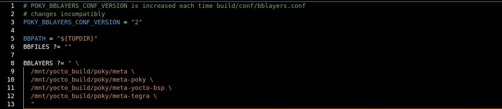

> **Note:** with `kirkstone`, `meta-openembedded` was **not** added in this setup, because it can cause build conflicts with `meta-tegra`.

### Edit `conf/local.conf`

Open `conf/local.conf` in your build directory and set the machine. The `MACHINE` value must match a machine file in `meta-tegra/conf/machine/`:

```conf
MACHINE ?= "jetson-nano-devkit"
IMAGE_CLASSES += "image_types_tegra"
IMAGE_FSTYPES = "tegraflash"
ENABLE_UART = "1"
```

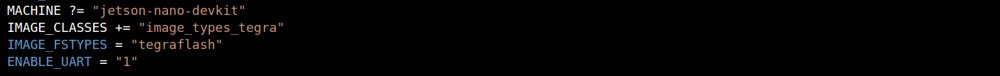

`ENABLE_UART = "1"` enables the serial console used in [section 9](#9-flash-the-bootloader-and-boot).

---

## 7. Build the image

Install the packages Yocto needs on your host first, then build the image you want:

```bash
bitbake core-image-full-cmdline
```

(or `core-image-base`, or any other image recipe).

No errors were encountered building for the Jetson Nano B01. Errors seen when building for the Orin Nano are listed in [section 14](#14-notes-for-jetson-orin-nano).

---

## 8. Write the root filesystem to the microSD card

When the build finishes, go to the deploy directory:

```bash
cd build/tmp/deploy/images/jetson-nano-devkit
```

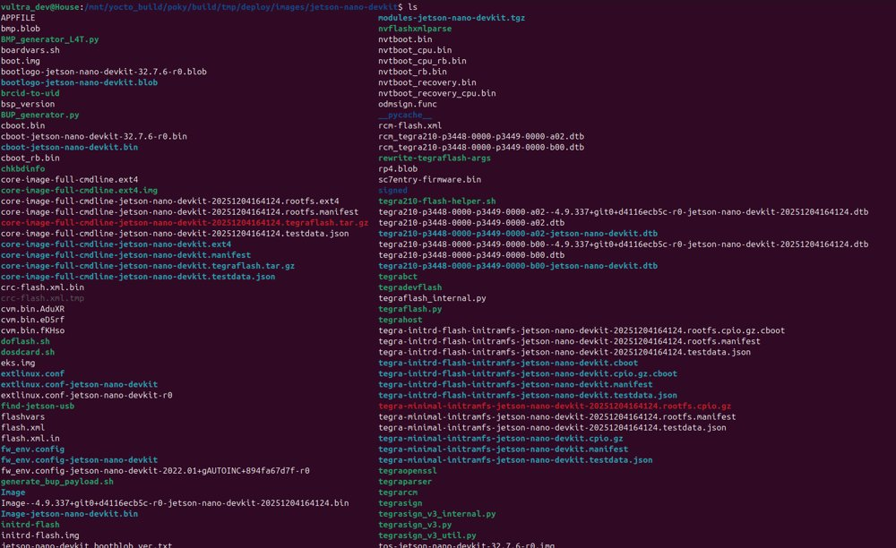

You will see several artifacts. The number in the file name is a **timestamp**; use the file that matches **your** build. Extract the `*.tegraflash.tar.gz` for your image, which contains the flashing scripts.

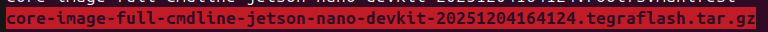

Among the extracted files, two scripts matter most:

- `dosdcard.sh` writes the root filesystem to the microSD card.
- `doflash.sh` flashes the bootloader to the board (see [section 9](#9-flash-the-bootloader-and-boot)).

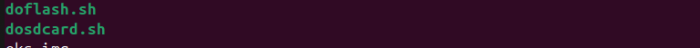

### Place `.rootfs.ext4` next to the scripts

`dosdcard.sh` does **not** search subdirectories. It only uses files that are in the same directory as the script. If `*.rootfs.ext4` is missing from that level, the script may flash a different artifact (such as a raw or sparse image), which produces a filesystem without a superblock and the board will fail to mount or boot.

**Correct layout** (all in the same directory):

```text
tmp/deploy/images/jetson-nano-devkit/
├── core-image-base-jetson-nano-devkit-<timestamp>.rootfs.ext4
├── core-image-base-jetson-nano-devkit.ext4
├── core-image-base-jetson-nano-devkit.ext4.img
├── dosdcard.sh
├── doflash.sh
└── ...
```

**Wrong layout** (the `.rootfs.ext4` is hidden in a subdirectory):

```text
tmp/deploy/images/jetson-nano-devkit/
├── core-image-base-jetson-nano-devkit-<timestamp>.tegraflash/
│   └── core-image-base-jetson-nano-devkit-<timestamp>.rootfs.ext4
```

Why: the script is designed for a production flow. It assumes artifacts are deployed in the standard Yocto layout and deliberately has no recursive search, to avoid flashing the wrong file.

- **Recommended:** do not extract the `.tegraflash.tar.gz` by hand just to reach the rootfs; use the `.rootfs.ext4` that is already in the deploy directory.
- **If you must extract:** copy the file up a level afterwards:

  ```bash
  cp core-image-base-jetson-nano-devkit-*.rootfs.ext4 tmp/deploy/images/jetson-nano-devkit/
  ```

### Pre-flash check

```bash
pwd
ls *.rootfs.ext4
file *.rootfs.ext4
```

The output of `file` should contain `Linux rev 1.0 ext4 filesystem data`. You can also syntax-check the scripts:

```bash
sh -n dosdcard.sh
sh -n doflash.sh
```

### Write the card

1. Insert the microSD card into your computer and check its partitions with `lsblk`. Delete any old partitions.
2. Run the script with **your card's device node** (here `/dev/mmcblk0`):

   ```bash
   sudo ./dosdcard.sh /dev/mmcblk0
   ```

   > **Warning:** this erases the target device. Double-check the device name with `lsblk` before running it.

3. When asked whether to create a new partition layout, answer `yes`. Writing takes a while depending on the image (about 15 minutes for `core-image-full-cmdline`).

   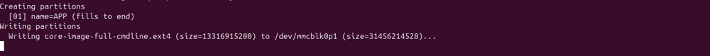

4. Run `lsblk` again. If the new partitions appear, the card was written successfully.

   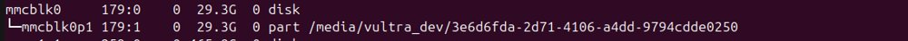

---

## 9. Flash the bootloader and boot

1. **Enter recovery mode.** On the J50 header, place the jumper across the **FC REC** and **GND** pins.

   Header without a jumper:

   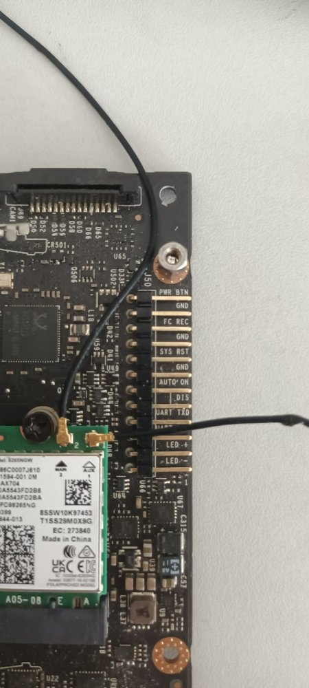

   Jumper installed (recovery mode):

   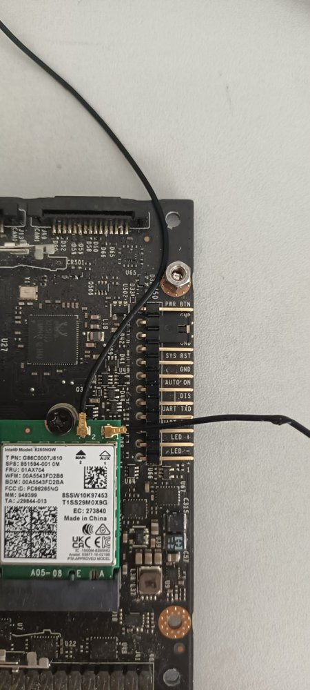

2. **Connect the board.** Connect the Jetson's micro-USB port to a USB 3.0 port on your computer.
3. **Check detection.** Run `lsusb` and look for an NVIDIA device entry. If it is listed, the board is in recovery mode and connected.
4. **Flash:**

   ```bash
   sudo ./doflash.sh
   ```

5. **Return to normal boot.** Disconnect the USB cable, move the jumper back to its normal position, and connect the DC power jack. In the author's setup the jumper sits on the **DC EN** header next to the barrel jack:

   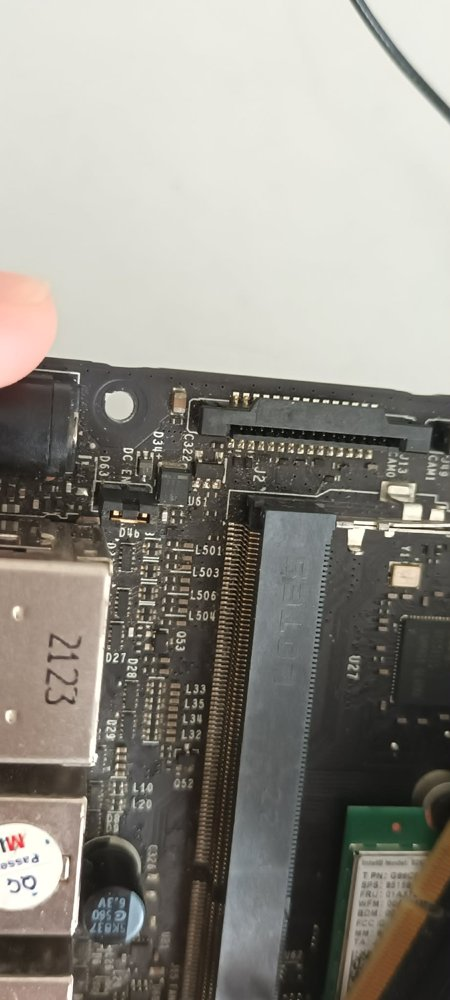

6. **Boot.** Insert the microSD card. To watch the boot log, either connect a UART adapter (see the Jetson Nano pinout) and run:

   ```bash
   sudo minicom -D /dev/ttyUSB0 -b 115200
   ```

   or connect an HDMI monitor. The result should be your Yocto image (for example `core-image-full-cmdline`) booting to a login prompt:

   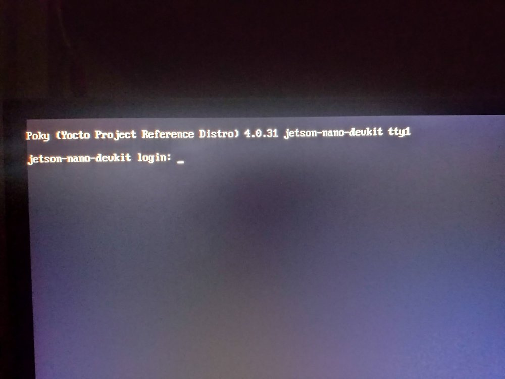

---

## 10. Build out-of-tree kernel modules (`.ko`)

This uses the Yocto SDK to cross-compile against the kernel that Yocto built.

> The examples below use the author's paths. Replace them with your own. They assume the Yocto SDK is already installed (here at `/opt/poky/4.0.31`).

### One-time preparation

From the `poky` directory:

```bash
source oe-init-build-env
bitbake virtual/kernel -c configure
```

Find the kernel build directory (the `B=` value):

```bash
bitbake -e virtual/kernel | grep ^B=
```

Example (the author's setup):

```text
/mnt/yocto_build/poky/build/tmp/work/jetson_nano_devkit-poky-linux/linux-tegra/4.9.337+gitAUTOINC+d4116ecb5c-r0/linux-jetson_nano_devkit-standard-build
```

### In every new terminal

```bash
source /opt/poky/4.0.31/environment-setup-armv8a-poky-linux
export KDIR=<path-to-kernel-build-dir-from-above>
echo $CROSS_COMPILE      # verify the SDK environment is loaded
```

Kernel version for reference: `4.9.337-l4t-r32.7.6+gd4116ecb5c13`.

### Fix: SDK `LDFLAGS` break the kernel module build

Sourcing the SDK environment exports `LDFLAGS`, which in Yocto usually contains options like `-Wl,-O1` (meant for user-space applications). Kbuild invokes the linker (`ld`) directly and does not understand `-Wl,...` (those are `gcc` flags forwarded to `ld`), so the module link fails.

**Option 1: unset `LDFLAGS` before `make`.**

```bash
source /opt/poky/4.0.31/environment-setup-armv8a-poky-linux
unset LDFLAGS
make
```

**Option 2: make the module `Makefile` robust.**

```makefile
obj-m += hello.o

# Use KDIR from the environment if set, otherwise fall back to a default path
KDIR ?= /path/to/linux-jetson_nano_devkit-standard-build
PWD := $(shell pwd)

# Force LDFLAGS empty for the kernel build to avoid the -Wl error
all:
	$(MAKE) -C $(KDIR) M=$(PWD) ARCH=$(ARCH) CROSS_COMPILE=$(CROSS_COMPILE) LDFLAGS="" modules

clean:
	$(MAKE) -C $(KDIR) M=$(PWD) ARCH=$(ARCH) CROSS_COMPILE=$(CROSS_COMPILE) clean
```

**Option 3: check `ARCH` and `CROSS_COMPILE`.**

```bash
echo $ARCH            # should be arm64
echo $CROSS_COMPILE   # should end in aarch64-poky-linux-
```

The Linux kernel only accepts `ARCH=arm64`, not `armv8a` (the name used by the SDK setup script). If the error persists, pass the values explicitly:

```bash
make ARCH=arm64 CROSS_COMPILE=aarch64-poky-linux- LDFLAGS=""
```

---

## 11. Transfer a module over UART

Use `minicom` and XMODEM to copy a `.ko` file to the board when there is no network:

1. On the host, open the serial console:

   ```bash
   minicom -D /dev/ttyUSB0 -b 115200
   ```

2. In the Jetson's console, run `rx <file.ko>`.
3. In minicom press `Ctrl-A` then `S`, and choose **xmodem**.
4. Select the path of the `.ko` file to send.

---

## 12. Verify the module and device tree overlays

Check whether a module is loaded:

```bash
lsmod | grep <module-name>
dmesg | tail
```

Compile a device tree overlay:

```bash
dtc -@ -I dts -O dtb -o gpio-test-overlay.dtbo gpio-test-overlay.dts
```

---

## 13. Troubleshooting

| Symptom | Cause | Fix |
| --- | --- | --- |
| Image builds but does not run | Wrong `meta-tegra` branch or machine for the board | Re-check [section 3](#3-select-the-meta-tegra-branch) and [section 4](#4-identify-your-board-and-machine) |
| Board fails to mount rootfs / boot fails after `dosdcard.sh` | `.rootfs.ext4` not in the same directory as the script, so a wrong artifact was written | See [section 8](#8-write-the-root-filesystem-to-the-microsd-card) |
| Module link fails with `-Wl` errors | SDK `LDFLAGS` leak into Kbuild | `unset LDFLAGS` or pass `LDFLAGS=""` ([section 10](#10-build-out-of-tree-kernel-modules-ko)) |
| Module build fails on `ARCH` | `ARCH` is `armv8a` | Use `ARCH=arm64` |
| Permission denied in the build directory | Directory owned by another user | `sudo chown $USER:$USER <path>` |

---

## 14. Notes for Jetson Orin Nano

The Orin Nano uses a newer Tegra generation, so the Nano B01 setup above does not apply directly.

- **Yocto release:** use `whinlatter`. It is no longer published as a branch in `poky`, so download it and extract it into the `poky` directory. Source commit: <https://git.yoctoproject.org/poky/commit/?id=5049bc18a8fe96ff388606471fa36761468fdd0e>
- **meta-tegra:** no branch switch is needed; `master` already carries the newest support, including the `jetson-orin-nano-devkit` machines.

  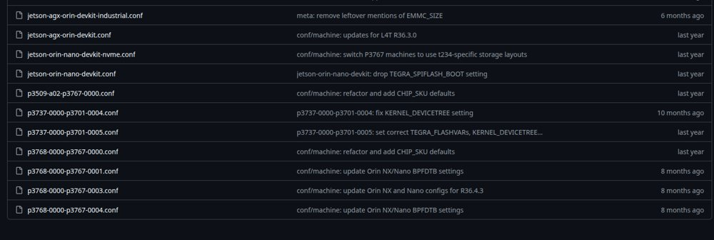
- **GCC:** update the host compiler to **14.x or newer**. Older versions fail to compile some files and produce `undefined reference to main`.

Errors encountered when building for the Orin Nano (not seen on the Nano B01):

1. **A recipe fails because of `go-mod-update-modules`.** The error was `Could not inherit file classes/go-mod-update-modules.bbclass` in `meta-openembedded/meta-oe/recipes-extended/simpleiot/simpleiot_0.18.4.bb`. Open the affected `.bb` file and remove `go-mod-update-modules` from the `inherit` line. This Go class is too old and is incompatible with `meta-openembedded`.

   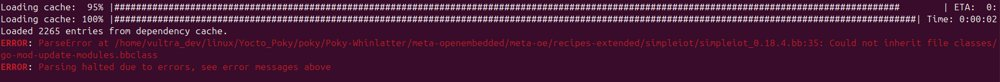
2. **`no recipes in default available for ...` in `recipes-graphics` (from `meta-tegra`).** Open the file named in the error and rename it so the layer skips it when loaded.
